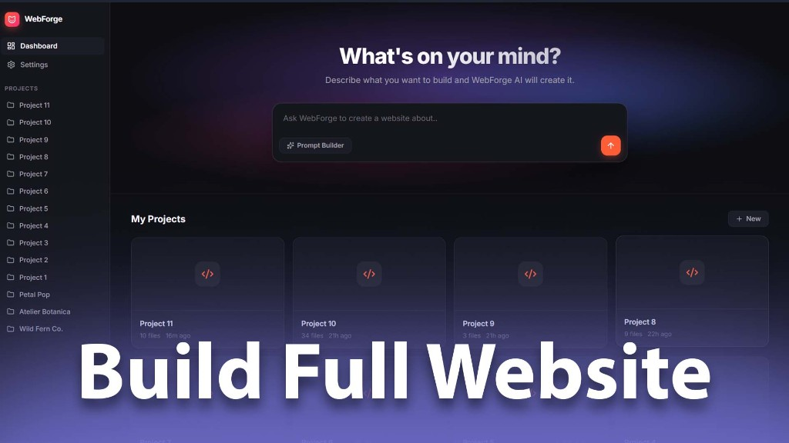
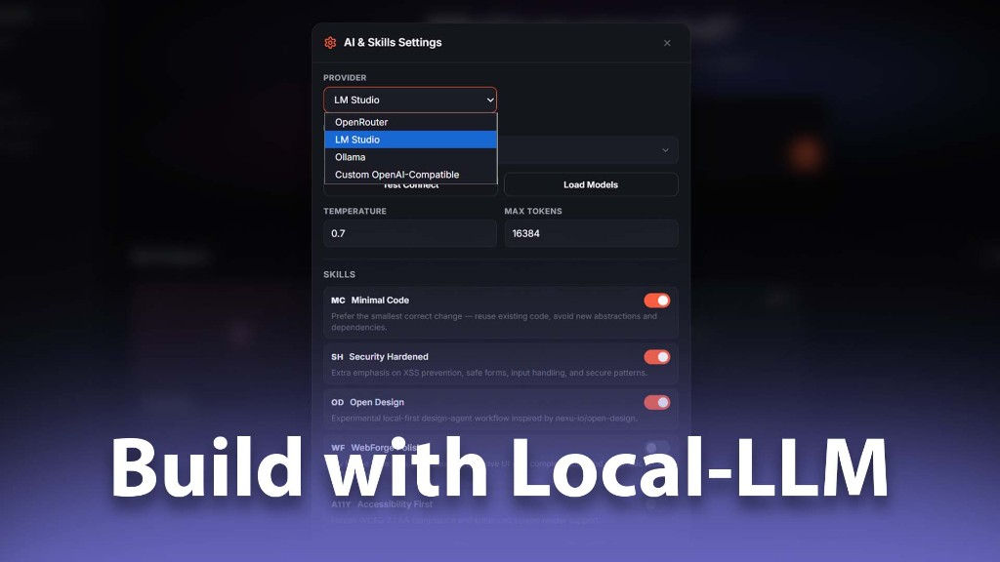

# WebForge

**Describe a site. Forge it live.**

A free, open-source AI website builder that runs entirely in your browser. Chat what you want — or use the Prompt Builder — and WebForge generates a multi-file React + Tailwind app with an instant sandboxed preview.

No backend. Your API keys and projects stay on your device.

<p align="center">
  
</p>

<p align="center"><em>Build a full website from a single prompt.</em></p>

---

## Why WebForge

| | |
|---|---|
| **Local-first** | Keys & projects live in `localStorage` — nothing is shipped to a WebForge server |
| **Full sites** | Multi-file React apps, not one-shot HTML dumps |
| **Live preview** | Babel + Tailwind in a sandboxed iframe, right in the browser |
| **Your model** | OpenRouter, LM Studio, Ollama, or any OpenAI-compatible API |
| **Skills** | Toggleable system-prompt extensions for security, a11y, polish, and more |

---

## Skills & local LLMs

Tune how the AI writes code with built-in **Skills**, and run everything against a local model when you want privacy and control.

<p align="center">
  
</p>

<p align="center"><em>Build with a local LLM — Skills shape every generation.</em></p>

### Built-in skills

| Skill | What it does |
|-------|----------------|
| **Minimal Code** | Smallest correct change — reuse existing code, skip unused abstractions |
| **Security Hardened** | XSS-safe patterns, safer forms, careful input handling |
| **Open Design** | Local-first design-agent workflow inspired by [open-design](https://github.com/nexu-io/open-design) |
| **WebForge Polish** | Focused, robust, responsive UI with complete, pragmatic output |
| **Accessibility First** | WCAG 2.1 AA emphasis and stronger screen-reader support |

Import custom skills from GitHub (`AGENTS.md` / `README.md`) and toggle any mix per session.

### Providers

- **OpenRouter** — cloud models with an API key  
- **LM Studio** — local server (default `http://localhost:1234`)  
- **Ollama** — local server (default `http://localhost:11434`)  
- **Custom** — any OpenAI-compatible base URL + key  

---

## Features at a glance

- Chat-driven generation and surgical follow-up edits  
- Prompt Builder for structured site briefs  
- Multi-project dashboard with export (ZIP / static HTML)  
- Live sandboxed preview (React, Tailwind CDN, Lucide)  
- Skill dock + Settings for temperature, max tokens, and model load  

---

## Quick start

**Requirements**
- A modern browser (Chrome, Edge, or Firefox)
- **Python 3.8+** *or* **Node.js 18+** for the local server
- Internet the first time you use live preview (CDN assets)

There is **no `npm install`**. The app is static HTML/CSS/JS.

### Windows

```bat
start.bat
```

The launcher checks files, finds Python or Node, starts a server on port **8000**, and opens the app.

### Any OS

```bash
python -m http.server 8000 --bind 127.0.0.1
# or
node tools/serve.mjs 8000
```

Then open [http://127.0.0.1:8000](http://127.0.0.1:8000).

Prefer the local server over `file://` — CDN scripts and the preview sandbox need it.

---

## Configure AI

1. Open **Settings**
2. Pick a provider and load models  
3. Adjust temperature / max tokens if you like  
4. Enable the Skills you want  
5. Save — keys stay in `localStorage` (`wf_provider`)

Clear site data anytime to wipe keys and local projects.

---

## Project layout

```
├── index.html
├── start.bat
├── css/
│   ├── app.css
│   └── prompt-builder.css
├── js/
│   ├── providers.js
│   ├── skills.js
│   ├── prompt-builder.js
│   ├── preview.js
│   ├── demos.js
│   ├── app.js
│   └── check-wizard-footer.js
├── docs/assets/          # README screenshots
├── README.md
├── LICENSE
└── AI_DEVELOPER_GUIDE.md
```

Script load order in `index.html` (do not reorder):

1. `providers.js` → 2. `skills.js` → 3. `prompt-builder.js` → 4. `preview.js` → 5. `demos.js` → 6. `app.js`

---

## Demo sites

First load seeds three flora-themed React demos:

1. **Petal Pop** — neighborhood florist  
2. **Atelier Botanica** — botanical studio  
3. **Wild Fern Co.** — nursery & garden market  

They behave like normal projects. Clearing site data re-seeds them.

---

## Security notes

- API keys leave your machine only for the provider you choose.  
- Preview runs in a sandboxed iframe — treat generated code as untrusted.  
- Built for local / trusted use. If you host the app publicly, each visitor’s keys stay in *their* browser — never bake your own keys into the source.

---

## License

MIT — see [LICENSE](LICENSE).
